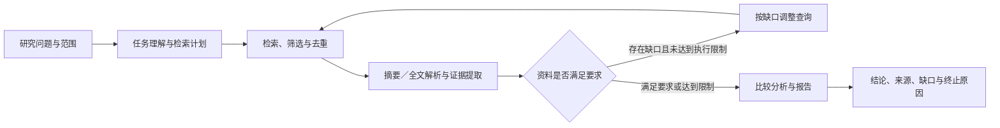

# Paper Scout

基于大语言模型的自主科研文献调研智能体。面向计算机相关领域，从研究问题出发，完成检索规划、论文获取、结构化分析、多文献比较和带来源的调研报告生成，并在发现资料缺口时进行有限轮次的补充检索。

**当前状态：开发文档阶段，尚未实现可运行系统。** 本仓库目前没有后端、前端、依赖清单或启动命令。下述功能和目录均为开发目标；文档中的阈值属于待实验验证的设计参数。

## 已确定的首期方案

| 项目 | 方案 |
| --- | --- |
| 交付形态 | 本地单用户、可演示的课程／毕设原型 |
| 后端 | Python＋FastAPI |
| 前端 | Vue 3＋TypeScript，前后端分离 |
| 智能体编排 | Python 显式状态机＋模型和工具适配器 |
| 模型与检索 | 用户自定义云端模型；支持 OpenAI Chat Completions、OpenAI Responses、Anthropic Messages 协议；检索 arXiv |
| 交互 | 可暂停任务、补充信息并继续；界面暂以对话和过程展示为设计方向 |
| 报告 | 默认 Markdown，支持 Word（.docx）和 PDF 导出 |
| 资源管理 | 保留用量统计及执行限制；不做金额预算功能 |
| 论文内容 | 元数据、摘要、可访问的文本型全文 PDF |
| 暂缓功能 | 用户上传 PDF、OCR、多人账号与权限、自动实验和投稿 |
| 尚待确定 | 用户实际使用的模型服务及其能力、arXiv 在目标网络的可达性 |

SQLite、本地文件存储和单独的串行 worker 是适配当前交付范围的建议；详见架构及决策记录。依赖版本在搭建工程时验证并锁定，不在文档中假定“最新版本”。

## 目标工作流程



执行中可请求暂停，在当前外部请求结束后的检查点停下；用户补充信息后，系统检查对既有计划和结果的影响，再继续同一次任务。

“找到论文”不等于“读过全文”，“存在引用”不等于“引用支持结论”。系统应记录实际读取范围，将论文事实、作者主张和系统推断分开；数据集或实验条件不一致时，不直接排列性能高低。

## 开发文档

| 文档 | 内容 |
| --- | --- |
| [需求与验收](docs/01-requirements.md) | 首期范围、需求编号、用户流程、可检查的完成条件 |
| [系统架构](docs/02-architecture.md) | 模块职责、前后端边界、任务执行、目录与部署建议 |
| [数据与接口](docs/03-data-and-api.md) | 任务、论文、证据、报告的数据约定和 HTTP 接口草案 |
| [智能体流程](docs/04-agent-workflow.md) | 状态流转、充分性判断、迭代检索、资源限制和报告规则 |
| [开发与评估](docs/05-development-and-evaluation.md) | 分阶段交付、必要测试、评价指标和复核方式 |
| [决策与待讨论项](docs/06-decisions.md) | 已确认选择、建议方案、开放问题和验证步骤 |
| [外部服务核验](docs/07-external-services.md) | 官方来源、接口限制、全文解析边界和接入前核验事项 |

协作开发前阅读 [AGENTS.md](AGENTS.md)。文档以 2026-10-29 的需求讨论为基础；外部服务说明仅表示官方资料已查阅，不代表已在本机完成接口调用。

## 计划工程结构

```text
paper-scout/
├── AGENTS.md
├── README.md
├── docs/                 # 需求、设计、决策与评估
├── backend/              # 待创建：API、状态机、适配器、持久化
├── frontend/             # 待创建：Vue 应用
├── tests/                # 待创建：关键行为测试与小型固定样本
├── data/                 # 运行时创建，Git 忽略
└── reports/              # 运行时导出，Git 忽略
```

## 下一步

搭建支持自定义模型服务的配置和三种协议适配器，并验证 arXiv 在目标网络中的可达性。实际运行前由用户配置服务、模型与凭据；离线样本用于开发和复现，真实检索结果另行标记，演示不得混用两者。

本地凭据放入未提交的 `.env`，后续提供不含密钥的 `.env.example`。依赖锁文件、脱敏测试样本和经过复核的示例报告应纳入版本管理。`CLAUDE.md` 是本地指向 `AGENTS.md` 的入口，按要求不提交。
