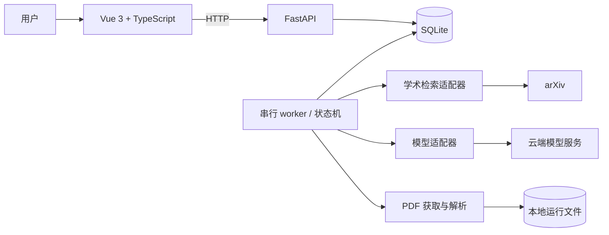

# 系统架构

状态：已有资料收集原型；2026-11-03 增加对话交互层。下文区分现有架构与未实现的分析、配置界面和导出目标。



## 设计边界

- 前端以对话为主：历史会话、真实消息时间线和统一输入框；论文、原文定位及报告作为资料区，执行过程可折叠。非重叠轮询更新持久化结果，不伪装成模型 token 流或内部思维。
- 会话复用 Task 标识；独立保存用户／助手消息、消息处理状态和引用，每个会话可有多个 Run。HTTP 只追加并排队消息，不在请求中调用云模型。串行 worker 先处理对话，再推进研究；模型只能选择固定的回答、澄清、研究或执行控制动作。
- 执行中发送消息先请求检查点暂停；判断为补充时追加 RunMessage，重新规划后继续同一 Run。仅由该消息暂时停下的研究可以自动继续；用户主动暂停、无法解释、格式错误或服务失败不能被自动恢复。终态后补充检索创建新 Run，资料追问不创建研究运行。
- 模型配置目前通过本地服务端环境配置加载；配置界面仍是后续目标。未来若在本地界面提交配置，凭据不在配置读取接口、日志或结果中回显，浏览器不持久保存。
- FastAPI 负责输入、查询、消息排队、启动、暂停、补充、继续和取消请求，返回持久化状态。一次运行保留最初输入和按时间追加的补充信息；暂停后继续同一运行，终态后的重新执行创建新运行。
- worker 与 FastAPI 共用应用 lifespan，在同一进程串行处理对话和研究。异步外部调用不会以同步等待阻塞 HTTP；首期仅一个后端进程／worker，不使用每请求 BackgroundTasks 或分布式队列。
- SQLite 保存任务、运行、查询、论文、证据和报告元数据；运行文件保存在本地 `data/`，用户导出到 `reports/`。SQLite 是建议，适用本地单机和低写入并发；事务不跨网络请求。
- 检索、模型和 PDF 各自提供窄接口；检索源负责转换外部格式，业务规则不放入适配器。首期接入 arXiv；目标网络的可达性仍需实际验证。
- 云端模型协议分别实现 OpenAI Chat Completions、OpenAI Responses 和 Anthropic Messages 适配器，用户选择协议、服务地址、模型与凭据；不同服务对可选能力的支持需要单独核验，不假定完全兼容。
- 当前输出持久化的阶段性 Markdown 报告。后续 Word／PDF 应由同一结构化结果生成，确保标题、表格、引用和缺失说明一致；格式转换不可用时明确报错，保留已有报告。
- 启动 worker 时将上次遗留的执行中或等待暂停的任务标为中断，保留记录；已暂停或等待补充的任务保持原状态。中断后用户可发起新运行。该规则依赖单 worker，不能直接用于多 worker 部署。

## 模块职责

| 模块 | 输入 | 输出 |
| --- | --- | --- |
| 任务服务 | 用户问题与范围 | 任务与不可变运行快照 |
| 规划 | 研究目标、已有缺口 | 子问题、关键词和检索条件 |
| 检索与整理 | 查询与来源 | 原始记录、规范化论文、去重关系 |
| 内容处理 | 论文记录与允许访问的 URL | 摘要或按页提取的文本、读取状态 |
| 提取与比较 | 已读取文本和关注维度 | 字段、来源定位、缺项及比较 |
| 评估 | 目标、论文、证据和执行限制 | 覆盖结果、缺口、继续或终止原因 |
| 报告 | 经检查的分析与来源 | 可读报告与参考文献 |

## 目录建议

```text
backend/
  app/api/          # 路由和请求响应
  app/domain/       # 类型、状态与业务规则
  app/workflow/     # 编排、阶段和执行限制
  app/adapters/     # 检索、模型、PDF
  app/storage/      # SQLite 和本地文件
frontend/
  src/views/        # 任务、执行、结果页面
  src/components/
  src/api/          # 后端 HTTP 客户端
  src/types/
tests/              # 关键行为测试、脱敏固定样本
```

仅在实际编码时创建需要的目录。数据库迁移、打包方式及开发命令随工程初始化确定并写入 README，不能宣称现已支持。

## 内容及安全边界

服务端只接受配置允许的学术源提供的公网 PDF 地址；对每次重定向重新检查目标，拒绝回环、内网和本机服务，限制下载体积与解析时间。这些措施针对自动获取外部 URL 的直接风险，按最小实现。PDF 文本解析失败、扫描件、表格丢失须标明缺项，不做 OCR。下载或读取某页不证明表格数值解析正确。

模型部署方式已确定为云端；用户问题、摘要和用于分析的全文片段可能发送给供应商。具体供应商、发送范围及其数据处理政策仍需在接入时确认。日志记录操作、错误类别和计数，不记录密钥或整篇原文。
