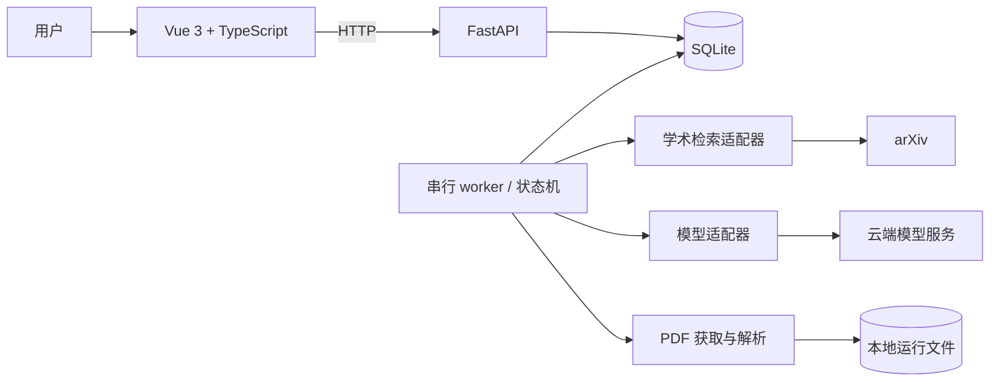

# 系统架构

状态：首期技术方向已确认；本文件为实现设计草案，尚无代码。



## 设计边界

- 前端提供对话式任务输入、历史列表、执行过程、论文详情、对比和报告；当前参考 Codex 的交互方式，具体布局可调整。采用轮询更新，频率在实现时根据体验确定。
- 模型配置可在本地界面提交至服务端保存，凭据仅用于服务端调用，不在配置读取接口、日志或结果中回显；浏览器提交时会接触密钥，不在前端持久保存。
- FastAPI 负责输入、查询、启动、暂停、补充、继续和取消请求，返回持久化状态。一次运行保留最初输入和按时间追加的补充信息；暂停后继续同一运行，终态后的重新执行创建新运行。
- worker 串行读取待执行运行并推进明确的状态机。建议与 API 分进程，以免长任务阻塞请求；首期只启动一个 worker，不引入分布式队列。
- SQLite 保存任务、运行、查询、论文、证据和报告元数据；运行文件保存在本地 `data/`，用户导出到 `reports/`。SQLite 是建议，适用本地单机和低写入并发；事务不跨网络请求。
- 检索、模型和 PDF 各自提供窄接口；检索源负责转换外部格式，业务规则不放入适配器。首期接入 arXiv；目标网络的可达性仍需实际验证。
- 云端模型协议分别实现 OpenAI Chat Completions、OpenAI Responses 和 Anthropic Messages 适配器，用户选择协议、服务地址、模型与凭据；不同服务对可选能力的支持需要单独核验，不假定完全兼容。
- 报告以同一结构化结果生成 Markdown、Word、PDF，确保标题、表格、引用和缺失说明一致；格式转换不可用时明确报错，保留已有报告。
- 启动 worker 时将上次遗留的执行中或等待暂停的任务标为中断，保留记录；已暂停或等待补充的任务保持原状态。中断后用户可发起新运行。该规则依赖单 worker，不能直接用于多 worker 部署。

## 模块职责

| 模块 | 输入 | 输出 |
| --- | --- | --- |
| 任务服务 | 用户问题与范围 | 任务与不可变运行快照 |
| 规划 | 研究目标、已有缺口 | 子问题、关键词和检索条件 |
| 检索与整理 | 查询与来源 | 原始记录、规范化论文、去重关系 |
| 内容处理 | 论文记录与允许访问的 URL | 摘要或按页提取的文本、读取状态 |
| 提取与比较 | 已读取文本和关注维度 | 字段、来源定位、缺项及比较 |
| 评估 | 目标、论文、证据和执行限制 | 覆盖结果、缺口、继续或终止原因 |
| 报告 | 经检查的分析与来源 | 可读报告与参考文献 |

## 目录建议

```text
backend/
  app/api/          # 路由和请求响应
  app/domain/       # 类型、状态与业务规则
  app/workflow/     # 编排、阶段和执行限制
  app/adapters/     # 检索、模型、PDF
  app/storage/      # SQLite 和本地文件
frontend/
  src/views/        # 任务、执行、结果页面
  src/components/
  src/api/          # 后端 HTTP 客户端
  src/types/
tests/              # 关键行为测试、脱敏固定样本
```

仅在实际编码时创建需要的目录。数据库迁移、打包方式及开发命令随工程初始化确定并写入 README，不能宣称现已支持。

## 内容及安全边界

服务端只接受配置允许的学术源提供的公网 PDF 地址；对每次重定向重新检查目标，拒绝回环、内网和本机服务，限制下载体积与解析时间。这些措施针对自动获取外部 URL 的直接风险，按最小实现。PDF 文本解析失败、扫描件、表格丢失须标明缺项，不做 OCR。下载或读取某页不证明表格数值解析正确。

模型部署方式已确定为云端；用户问题、摘要和用于分析的全文片段可能发送给供应商。具体供应商、发送范围及其数据处理政策仍需在接入时确认。日志记录操作、错误类别和计数，不记录密钥或整篇原文。
