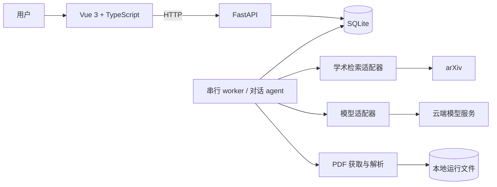

# 系统架构

状态：已有对话 agent（含阅读子 agent）、资料收集、证据记录和三格式报告原型；真实服务兼容性与科研语义质量不由离线验证证明。



## 设计边界

- 界面偏好由前端管理：主题为亮色、暗色、跟随系统，默认跟随系统；首屏前应用主题并监听系统变化。配色通过语义变量覆盖主界面、资料区、菜单与弹窗，采用中性黑白灰。通用设置控制发送快捷键、默认消息模式和自动滚动；外观另控制对话字号与宽度。浏览器只持久保存这些非敏感偏好，不保存密钥或研究内容；存储不可用时仅当前页面生效。默认模式仅作用于未手动指定模式的对话。
- 对话导出直接使用前端已加载的会话快照：Markdown 包含消息和引用摘录，JSON 另含任务、运行和用量。不会读取其他会话、模型凭据或未发送草稿；论文全文与报告文件不打包，不能作为完整数据库备份。恢复默认偏好不调用模型／会话修改接口。
- 设置的研究与用量页分开展示当前会话／所选调研的实际消耗和服务端只读上限。直接使用已加载的 ConversationView 与 Run 保存值，随现有对话轮询更新；切换历史调研不被后续轮询重置。Token 缺失保持未知，已有记录上限不由默认上限覆盖，不新增全站统计或费用估算接口。
- 前端以对话为主：采用Codex桌面端式的窄侧栏、紧凑标题栏、连续助手正文、右对齐用户消息和稳定底部输入区。桌面侧栏可收起；论文、原文定位及报告作为按需资料区，执行过程可折叠。模型／消息模式与发送／停止在输入区操作，执行中可直接发送补充，用量保持可访问。非重叠轮询更新持久化结果，不伪装成模型 token 流或内部思维。
- 助手正文使用Markdown排版，禁用原始HTML和自动加载图片，危险链接协议由解析器入口过滤；引用仍通过结构化证据按钮打开已保存快照。后台刷新保留已有内容，不重新插入加载占位；仅在内容高度变化且用户允许跟随、仍接近底部时自动滚动。历史列表按实际更新时间排序，不因读取会话而置顶。
- 会话重命名独立于研究问题；删除在同一短事务内停止当前工作并软删除，回收站恢复不自动执行。独立回收站按服务端分页、搜索与排序；批量恢复和彻底删除在单一事务内完成，删除前检查目标会话的在途 worker，请求结束前拒绝清除；共用论文和来源由存储层按实际关联保留。
- 会话复用 Task 标识；独立保存用户／助手消息、消息处理状态、引用和每轮工作状态。HTTP 只追加并排队消息，不在请求中调用云模型。串行 worker 每次处理一个会话的一轮，交给该会话的 agent；agent 在一个 `agent=true` 的工作区 Run 上跨轮次工作（执行规则见 [对话 agent](<04-agent-workflow.md>)）。
- 执行中发送的消息直接排队，agent 在下一次模型调用前并入当前轮，沿用同一工作区和本轮额度；无需暂停或重新规划。停止取消在途请求并中断该会话的所有待处理消息。
- AI服务以供应商为配置单位：名称、协议、地址、一份凭据和多个已选模型ID。设置只负责配置、获取清单与删除；当前供应商和型号仅从对话菜单选择，保存不自动选择。正在使用的供应商只在空闲时修改／删除，不重置历史用量。
- 模型列表由服务端使用该供应商凭据请求 `/models`，不发送会话或调用生成，支持Anthropic分页；外部超时、鉴权、限流和格式错误明确反馈。浏览器只持有用户本次输入的密钥，不持久化或回显已保存凭据。更改地址不能直接复用旧密钥。
- 本机AI服务文件原子保存并优先于环境配置。已知旧单模型及profiles结构读取时迁移，协议／地址／凭据完全相同才合并为一家供应商，保留当前型号和不同凭据。旧文件直到下一次保存才改写。
- FastAPI 负责输入、查询、消息排队和停止请求，返回持久化状态；不在请求中执行 agent。
- worker 与 FastAPI 共用应用 lifespan，在同一进程串行处理对话轮次；轮内的阅读子 agent 以 asyncio 任务并发（最多 3 个），模型请求在轮内排队、同时只发 1 个，随本轮结束或停止一起回收。异步外部调用不会以同步等待阻塞 HTTP；首期仅一个后端进程／worker，不使用每请求 BackgroundTasks 或分布式队列。
- SQLite 保存任务、运行、查询、论文、证据和报告元数据；数据库与本机 AI 服务设置保存在 `DATA_DIR`（默认 `data/`）；报告导出由浏览器直接下载，服务端不另存导出文件。SQLite 适用本地单机和低写入并发；事务不跨网络请求。
- 检索、模型和 PDF 各自提供窄接口；检索源负责转换外部格式，业务规则不放入适配器。首期接入 arXiv；目标网络的可达性仍需实际验证。
- 云端模型协议分别实现 OpenAI Chat Completions、OpenAI Responses 和 Anthropic Messages 适配器，用户选择协议、服务地址、模型与凭据；不同服务对可选能力的支持需要单独核验，不假定完全兼容。
- `agent/service.py` 负责一轮的循环：组装上下文、调用模型、校验步骤、执行上限与收尾、插话、重试、上下文压缩和阅读子 agent；`agent/actions.py` 定义步骤协议；`agent/workspace.py` 执行工具并保存论文、原文、已读范围、证据、判断和报告；`prompts.py` 集中系统提示词。`analysis.py` 提供引文定位、论文分组、实验可比性等纯规则。适配器只负责协议请求，不承载研究规则。
- 逐篇分析记录不可变，每次 `note` 追加新记录，读取取最新一条；旧流水线的分析修订记录按原样只读。
- 当前报告同时保存结构化快照和 Markdown。`reports.py` 从同一快照生成 Markdown、Word/PDF，报告与评估在同一事务中保存；前端下载绑定报告 ID，不因最新报告变化而换版、不新增模型调用。历史 Markdown 不倒推结构化结论。
- 启动 worker 时将处理中的消息标为中断，不重放已发起的请求；旧流水线遗留的未结束运行一并标为中断并说明原因，资料保留。该规则依赖单 worker，不能直接用于多 worker 部署。

## 模块职责

| 模块 | 输入 | 输出 |
| --- | --- | --- |
| 对话存储 | 用户消息与请求标识 | 成对的消息、待处理轮次、插话合并、停止与中断 |
| 对话 agent | 一轮消息、会话历史、工作区概况与本轮上限 | 工具调用序列、事件、工作状态和最终回复 |
| 阅读子 agent | 一篇论文、主 agent 的背景与要求 | 已读范围、证据与总结 |
| 工作区工具 | 经校验的工具参数 | 检索结果、原文片段、核对后的证据、纳入判断、报告 |
| 适配器 | 查询、URL、模型请求 | arXiv 记录、按页 PDF 文本、模型输出与用量 |
| 报告渲染 | 报告结构化快照 | Markdown、Word、PDF |

## 目录结构

```text
backend/app/
  api/              # 路由和请求响应
  domain/           # 类型与状态
  agent/            # 对话 agent、步骤协议、工作区工具与串行 worker
  adapters/         # arXiv、模型、PDF 获取与解析
  storage/          # SQLite 与会话持久化
  prompts.py        # agent 与阅读子 agent 的系统提示词
  analysis.py       # 引文定位、论文分组与实验比较规则
  reports.py        # 报告快照与三格式渲染
  model_settings.py # 本机 AI 服务设置
frontend/src/
  components/       # 对话之外的资料区、设置、回收站等组件
  composables/      # 主题、偏好与菜单关闭
  api/              # 后端 HTTP 客户端
tests/              # 关键行为测试、浏览器回归脚本
```

运行与开发命令见 [README](<../README.md>)。

## 内容及安全边界

服务端只接受配置允许的学术源提供的公网 PDF 地址；对每次重定向重新检查目标，拒绝回环、内网和本机服务，限制下载体积与解析时间。代理软件 fake-ip 模式使用的基准测试保留段（`198.18.0.0/15`、`2001:2::/48`）视为可访问，因为白名单域名在该模式下只会解析到这里，且这些地址不承载本机或内网服务。这些措施针对自动获取外部 URL 的直接风险，按最小实现。PDF 文本解析失败、扫描件、表格丢失须标明缺项，不做 OCR。下载或读取某页不证明表格数值解析正确。

模型部署方式已确定为云端；用户问题、摘要和用于分析的全文片段可能发送给供应商。具体供应商、发送范围及其数据处理政策仍需在接入时确认。日志记录操作、错误类别和计数，不记录密钥或整篇原文。
